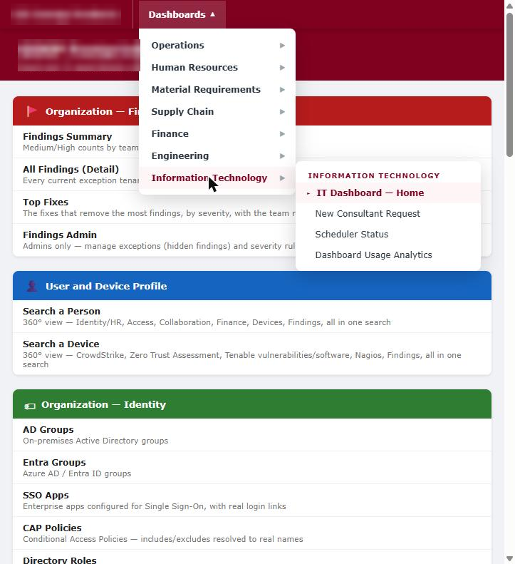
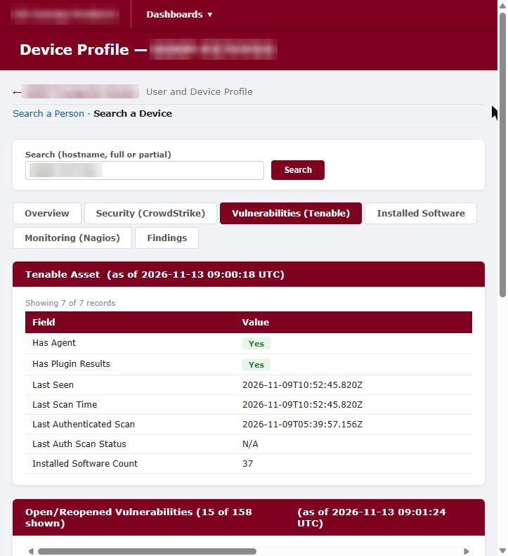
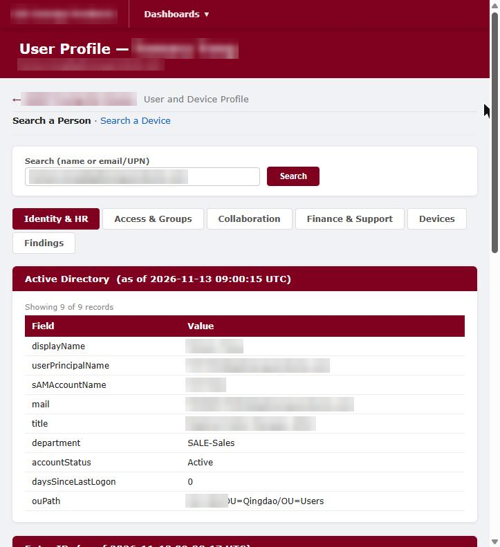
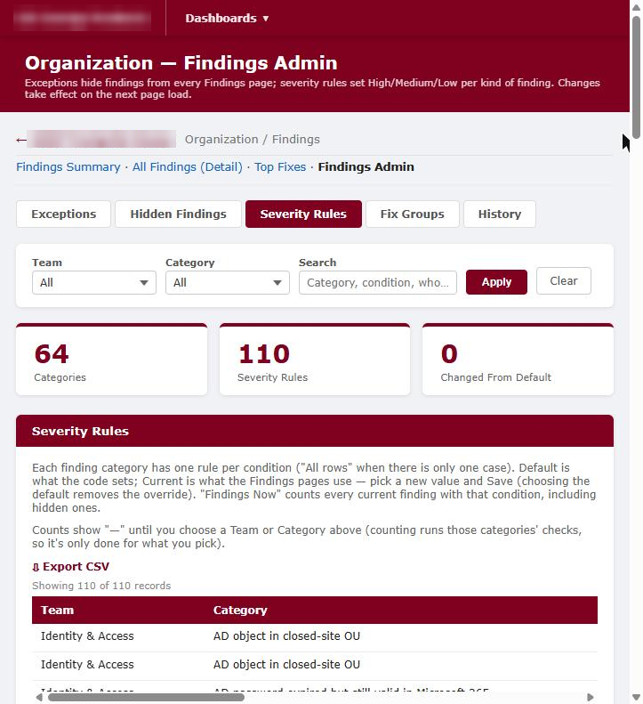
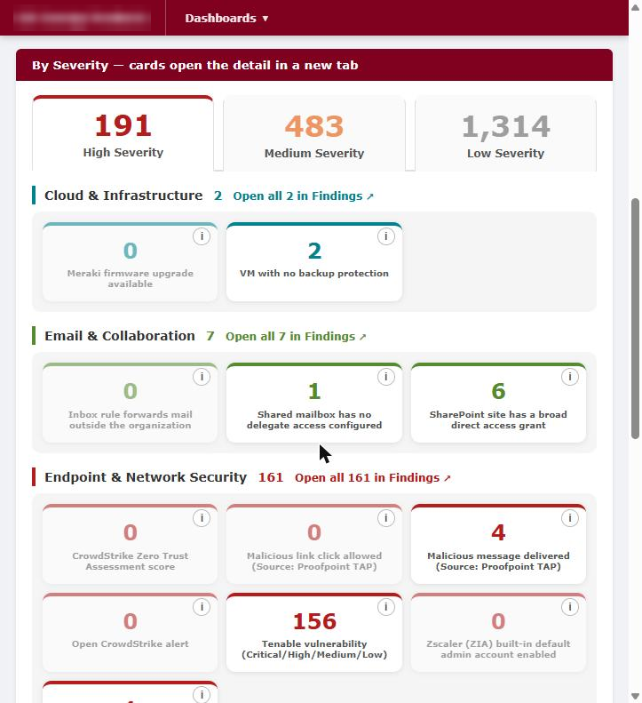
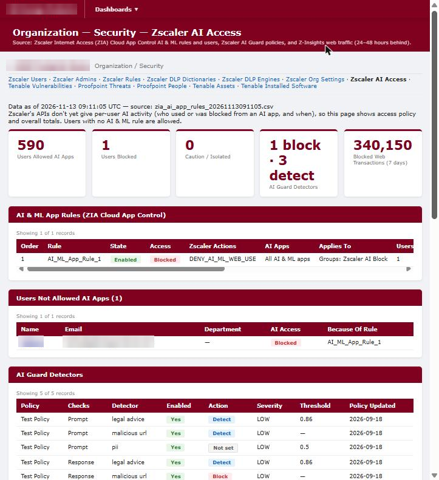

# Build vs. Buy: An IT Operations and Security Dashboard in a Week

## Part 1: Architecture and What It Buys Us

---

### 📚 **Series Navigation**
- **Part 1: Architecture and What It Buys Us** *(Current)*
- [Part 2: Findings That Fit How We Actually Work](it-dashboard-build-vs-buy-part2.md)

*Most IT teams don't need another console - they need the consoles they already have to answer one question together. This two-part series documents an IT operations and security dashboard we built in a week, with an LLM writing most of the code. Part 1 is the build-vs-buy reasoning and the architecture; [Part 2](it-dashboard-build-vs-buy-part2.md) is the findings engine.*

---

## Introduction

Every small and mid-sized IT team I know has the same problem, and it isn't a lack of tools. It's the opposite. Identity lives in Active Directory and Entra ID. Endpoint protection lives in one console, vulnerability scanning in another, web security in a third, email security in a fourth. Network gear, monitoring, backups, the ERP, the HR system and the ticketing system each have their own portal, their own login and their own idea of what a "device" or a "user" is.

Each of those consoles is good at its own job. None of them answers the questions an IT leader actually gets asked:

- Which of our laptops are missing the endpoint agent, the web security client or the vulnerability scanner — and who uses them?
- Someone left the company last week. Are they really gone everywhere, including the ERP?
- What are the ten things that, if we fixed them this month, would move the needle most — and which team owns each one?

The usual answer is a marketplace product: an asset inventory platform, a cyber-asset management tool, a vulnerability management suite, or a SIEM with a dashboard on top. We looked at that path. This series is about why we built our own instead, what the architecture looks like, and — the part I want to be upfront about — that the core of it was built in a week, with an LLM as my pair programmer.

This isn't an argument that buying is wrong. It's an argument that for a small or mid-sized organization, the economics of building changed in the last year, and it's worth re-running the numbers.

Part 1 covers the architecture and what it buys us. [Part 2](it-dashboard-build-vs-buy-part2.md) covers the findings themselves — what we check for, how findings change on their own as releases and patches move, and how we handle exceptions without hiding anything.

---

## Then vs. Now

| Question | Before | Now |
|---|---|---|
| "Is this laptop fully protected?" | Log in to four consoles, search the hostname in each, compare by eye | Search the hostname once; every system's view of that device on one page |
| "Who uses this vulnerable device, and where are they?" | Ask around, check the CMDB (if it's current) | Last logged-on user from the endpoint agent, office and location from HR attributes |
| "Is this leaver fully deprovisioned?" | A checklist and trust | A finding the morning after, in every system that still has them active |
| Monthly security review | Screenshots from each console, pasted into slides | One ranked list of fixes by severity and owning team, with month-over-month change |
| Adding a new check | Feature request to a vendor, or not possible | Hours |

---

## Why Not Just Buy a Tool?

The marketplace tools in this space are genuinely good. Before building, it's worth being honest about what they do well, and where they didn't fit us.

**What a bought tool gives you:** a polished UI, a large catalog of pre-built connectors, vendor support, and somebody else maintaining the integrations when an API changes.

**Where it didn't fit:**

1. **Connector coverage is broad, but not ours.** Every platform covers the big names — Entra, the major endpoint vendors, the major scanners. Few cover the long tail that a real company actually runs: an on-premises ERP, a niche HR/payroll system, a regional ticketing tool, a monitoring platform configured years ago. Those are exactly the systems where the gaps hide — a user terminated in HR but still active in the ERP is a finding no off-the-shelf connector was going to give us.

2. **The findings are theirs, not ours.** A bought tool ships a fixed set of checks with a fixed idea of severity. Our rules are specific: what counts as "patched" for a laptop that's on the road three weeks a month, which servers are intentionally excluded from a scan agent, when a device one release behind is acceptable. In a product those become feature requests. In our own code they're an afternoon.

3. **Pricing scales the wrong way for us.** Most tools in this category are priced per asset or per user. For a small or mid-sized company, that's a recurring cost that grows every time we add a device or a hire — for what is, underneath, reading data from APIs we already pay for.

4. **Another console is another console.** The problem was never a lack of dashboards. Adding one more vendor portal with its own login and its own data model doesn't consolidate anything unless it replaces the others — and it doesn't.

5. **The build cost collapsed.** This is the one that changed. A year ago, building this would have been months of a developer's time. With an LLM writing most of the code against my design, the core was live in a week, and each new finding since has taken hours. The thing that used to make "buy" the obvious answer — the cost of building — isn't the obstacle it was.

### Where Sentinel Fits

We run Microsoft Sentinel, and it isn't going anywhere. Sentinel is our SIEM: it ingests logs, correlates events and raises alerts in near real time when something is happening *right now*.

This dashboard answers a different question: what is the *state* of our environment today, and what should we fix? It's closer to a CMDB, an asset inventory and a vulnerability register joined together than it is to a SIEM. Sentinel tells me a risky sign-in just occurred. The dashboard tells me which accounts have been in a risky state all month, which devices have no endpoint agent, and which patch would close the most findings. One is the smoke detector; the other is the building inspection. We need both.

---

## Architecture Overview

The design is deliberately simple: read from every source by API, save what we read, and join it at read time.

```
 ┌────────────────────────────────────────────────────────────────────────────┐
 │ SOURCES (read-only API / SDK accounts)                                     │
 │                                                                            │
 │  Identity        Endpoint & Security        Infrastructure    Business     │
 │  • Active Dir.   • CrowdStrike (EDR, ZTA)   • Azure (VMs,     • ERP (SAP)  │
 │  • Entra ID      • Tenable (vulns, agents)    backup, AVD,    • HR/payroll │
 │  • Exchange      • Zscaler (ZIA, AI Guard,    billing)        • Ticketing  │
 │  • SharePoint      Z-Insights)              • Meraki          • Expense    │
 │                  • Proofpoint TAP           • Nagios                       │
 └──────────────────────────────────┬─────────────────────────────────────────┘
                                    │ scheduled extracts, nightly
                                    │ (one small job per source and object)
                                    ▼
 ┌────────────────────────────────────────────────────────────────────────────┐
 │ SNAPSHOT STORE (Azure file share)                                          │
 │  one folder per source/object, timestamped CSV per run                     │
 │  newest file + last file of each month kept → history for free             │
 └───────────────┬──────────────────────────────────────────┬─────────────────┘
                 │                                          │
                 ▼                                          ▼
 ┌───────────────────────────────────────┐   ┌────────────────────────────────┐
 │ IT DASHBOARD (web app, container)     │   │ MCP SERVER (same files)        │
 │  • per-source pages, unmodified       │   │  • ad-hoc questions in plain   │
 │  • User 360 and Device 360 (joined)   │   │    English from Claude Desktop │
 │  • Findings engine:                   │   │  • data catalog describes each │
 │      60+ checks → severity rules      │   │    folder for the LLM          │
 │      → exceptions (visible, never     │   └────────────────────────────────┘
 │        silent) → Top Fixes            │
 │  • monthly snapshot for trends        │
 └───────────────────┬───────────────────┘
                     │
                     ▼
     Nightly status email: did every source refresh?
     Monthly review: ranked fixes by team, month over month
```

<figure class="thumb" markdown>
{ loading=lazy }
<figcaption>The home page groups everything by area: findings, user and device profiles, identity, devices, security, network and cloud. The dashboard sits alongside the other business dashboards. (Names masked.)</figcaption>
</figure>

Three things are worth noticing in the diagram.

First, **nothing writes back.** Every connection uses a read-only API account or role. The dashboard can't change a firewall rule or disable a user, which makes it easy to approve, easy to audit and safe to give to more people.

Second, **the snapshot store is the contract.** Extract jobs don't know the dashboard exists, and the dashboard doesn't know how any extract talks to its source. If a vendor changes an API, one small extract job changes and nothing else does.

Third, **the same files feed an MCP server.** The [MCP Analytic Server series](ai-claude-mcp-analytic-server-part1.md) describes a server that lets Claude Desktop answer questions over our data. Because every source lands as a described file, any new source we add to the dashboard is also immediately available for ad-hoc questions in plain English — "which laptops in our largest office are missing the web security client?" — without building a page for it.

---

## Key Architectural Decisions

### 1. Read by API, from every source, on a schedule

Each source gets its own small extract job per object — users, groups, devices, vulnerabilities, rules — run nightly by a scheduler. Fifteen systems, dozens of jobs, each one independent. One source being down doesn't stop the rest, and a nightly status email shows exactly which source didn't refresh.

The reason to insist on API/SDK access, rather than exported reports or manual downloads, is simple: if a human has to export it, it will eventually stop being exported.

### 2. Keep each source's data as that source sees it

We don't merge Active Directory computers and Entra devices into one "device" table, or CrowdStrike hosts and Tenable assets into one list. Each source's pages show that source's records, unmodified. The joins happen at read time, in the User 360, the Device 360 and the findings.

This sounds like a small decision. It's the one that makes the findings trustworthy. When the dashboard says "this device has no Tenable agent", you can open the Tenable page and see for yourself. Nobody has to trust a merge rule they can't see.

### 3. Flat files, not a database

Every extract writes a timestamped CSV to a file share. We keep the newest file and the last file of each month. That gives us:

- **History without a data warehouse.** "How many findings did we have at the end of last month?" is one file.
- **Nothing to tune or patch.** No schema migrations when a vendor adds a field.
- **Files any tool can read.** The dashboard, the MCP server, Excel and a script all read the same data.

For a small or mid-sized environment — a few thousand objects per source — this is more than fast enough.

### 4. Join on what's actually reliable, not on a CMDB

The hardest problem in asset management isn't collecting data, it's knowing which records are the same thing. We use the join key each system actually populates reliably:

- **People:** email/UPN across cloud systems; the AD account name for the ERP.
- **Devices:** the hostname, case-insensitive, across the endpoint agent, AD, Entra and the scanner.
- **Device to person:** the *last logged-on user* reported by the endpoint agent, matched to the AD account — not an asset-assignment field somebody has to remember to update.
- **Person to place:** office and location from HR, passed into AD and Entra by our HR sync.

That chain — vulnerability → device → last logged-on user → office — means a finding on a laptop arrives with the person who uses it and where they are. Part 2 shows why that matters for a team supporting people who travel.

<div class="thumb-row" markdown>
<figure markdown>
{ loading=lazy }
<figcaption>Device 360: one search, a tab per system (endpoint, scanner, installed software, monitoring, findings). An empty tab is a finding in itself: this device isn't covered by that system. (Names masked.)</figcaption>
</figure>
<figure markdown>
{ loading=lazy }
<figcaption>User 360: identity and HR, access, collaboration, finance and support, devices and findings for one person. Department and office come from HR. (Names masked.)</figcaption>
</figure>
</div>

### 5. Findings are rules, severity is a setting, exceptions are visible

<figure class="thumb" markdown>
{ loading=lazy }
<figcaption>Severity per case is a setting, not a code change. Everyone can view it; three admins can edit it.</figcaption>
</figure>

A finding is a check written in code: "an enabled account that HR says is terminated", "a workstation with the endpoint agent but no web security client". Each check reports *which case* it found ("Expired" vs. "Expiring soon") and the severity for each case is a setting admins change from a screen — not a code change.

Exceptions work the same way. When we decide a finding is acceptable, it's recorded with a reason, who decided and when, and it shows up on an Exceptions tab everyone can see. Nothing is silently filtered, and nothing changes in the source system: an exception only changes how the dashboard counts that finding, so removing it brings the finding straight back. Part 2 goes into this in detail, including exceptions that create and remove themselves.

### 6. Built with an LLM, owned by us

I'll say this plainly: I didn't write most of this code by hand. I wrote the design — the sources, the join keys, the rules, the decisions above — and an LLM (Claude, working in my repository) wrote the extract jobs, the pages and the findings against it. I reviewed, tested against live data and corrected it when it was wrong — which it sometimes was, confidently.

The timeline:

- **Start:** a discovery document — every source, every object, the join keys, what "done" looks like.
- **One week later:** the dashboard live in production, replacing the previous IT dashboard, reading from every source.
- **Since then:** new findings, the exceptions model, monthly trends and the Top Fixes view, each added in hours as the review meetings asked for them.

What made that possible wasn't the LLM alone. It was the LLM combined with things a small IT team already has: API access to its own tools, a container platform, a scheduler and a person who knows what the questions are. The LLM removes the cost of typing the code. It doesn't remove the need to know what to build.

---

## What It Buys Us

<figure class="thumb" markdown>
{ loading=lazy }
<figcaption>Findings Summary: open findings by severity, then by owning team and check. Each card opens the detail.</figcaption>
</figure>

The short version: **better visibility gives better remediation, and better remediation gives better meetings.**

- **Visibility.** One place to see every user and every device, as every system sees it — including the gaps between systems, which is where risk lives.
- **Remediation.** Every finding has an owning team, a severity, the device or account, the person and their location — enough to act without a second investigation.
- **Meetings.** The monthly security review is one ranked list of fixes, by severity and team, with the change since last month. The conversation moved from "what's the state?" to "what are we fixing next?".
- **Our rules, not a vendor's.** A new check, a severity change or a new exception type is our decision, made in hours, not a feature request.
- **Cost.** Read-only API access to tools we already license, a small container and a file share. No per-asset fee that grows with every hire.
- **No lock-in.** The data is CSV files we own. If we ever do buy a platform, it can read them too.

---

## Lessons Learned

- **An empty result is a finding.** "This device isn't in the scanner" is more useful than any vulnerability the scanner could report. Show empty tabs; don't hide them.
- **The CMDB was the weakest join.** Last logged-on user from the endpoint agent turned out to be more accurate than any assignment record we'd maintained by hand.
- **Read-only accounts make approval easy.** Every API client is view-only. That one decision removed most of the security review.
- **Check the LLM's claims against live data.** Most of the corrections during the build came from asking "is that actually true in our tenant?" and checking.
- **Tell people when a refresh fails.** A nightly email listing every source and its last refresh caught expired credentials before anyone noticed stale data.

---

## Open Issues

<figure class="thumb" markdown>
{ loading=lazy }
<figcaption>Where the API stops: the AI access page shows the policy (who is allowed or blocked from AI apps, and what the AI guard detects or blocks) and overall totals, because per-user AI activity isn't available by API. (Names masked.)</figcaption>
</figure>

- **API limits are the vendor's, not ours.** Some data a console shows isn't available by API — for example, per-user AI activity in our web security platform. We list those gaps rather than working around them.

- **Ownership is "last logged on", not "assigned".** That's right for most laptops; shared devices and kiosks need a human answer.

---

## Closing Thought

If you run IT for a small or mid-sized organization, you probably already have most of what this needs: API access to the tools you pay for, somewhere to run a container and a list of questions your current consoles can't answer. What changed is the cost of turning that into a working system. It's no longer months. For us it was a week, and every improvement since has been measured in hours.

Buy where a product genuinely does the job better. But before signing a per-asset contract to consolidate data you already own, run the numbers again.

---

## References

- [Part 2: Findings That Fit How We Actually Work](it-dashboard-build-vs-buy-part2.md)
- [Data Analysis with LLM via MCP Server — Part 1](ai-claude-mcp-analytic-server-part1.md) — the MCP server that reads the same snapshot files
- [Data Analysis with LLM via MCP Server — Part 3](ai-claude-mcp-analytic-server-part3.md) — HTTPS and Entra ID OAuth for that server
- [Orchestrating Scheduled Jobs (Container Instances)](azure-container-schedule.md) — the scheduling pattern behind the nightly extracts
- [Entra Users, User Groups and License assignments](azure-ad-user.md) and [Entra User Devices](azure-ad-user-devices.md) — two of the original extracts

---

*This article documents a production implementation. Names, identifiers and tenant-specific values have been removed or generalized, and screenshots are masked.*
