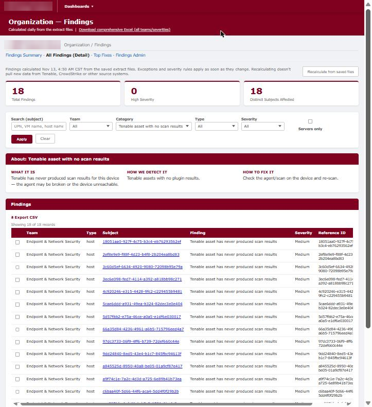
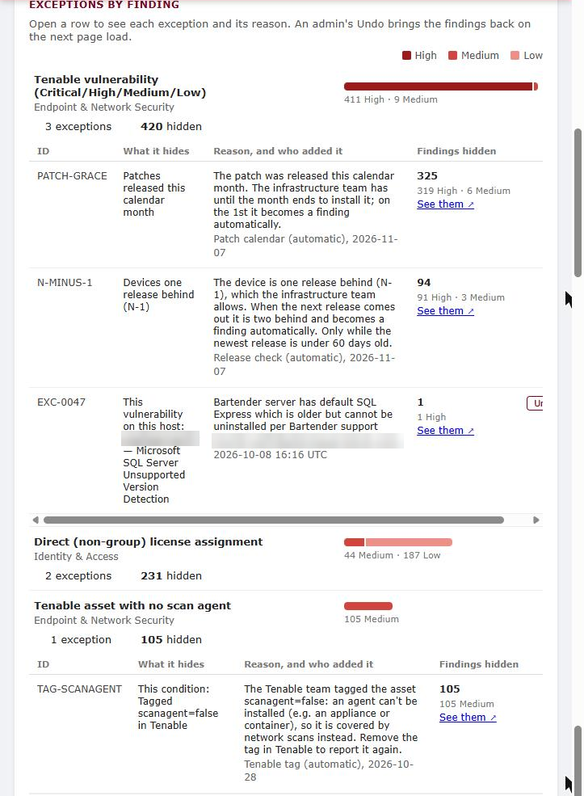
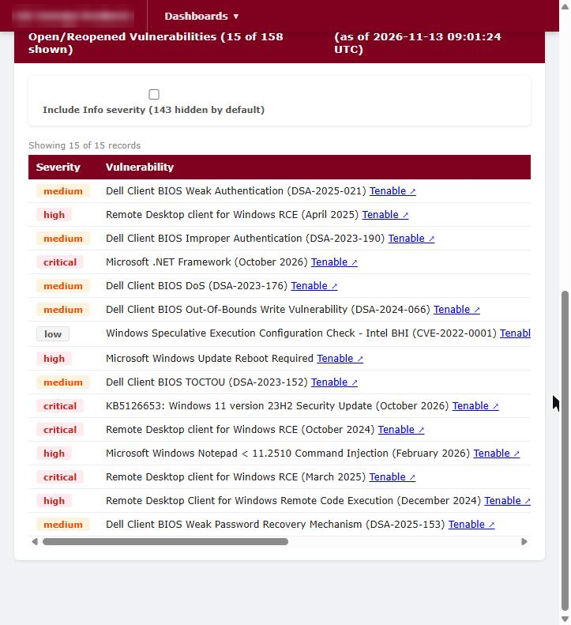
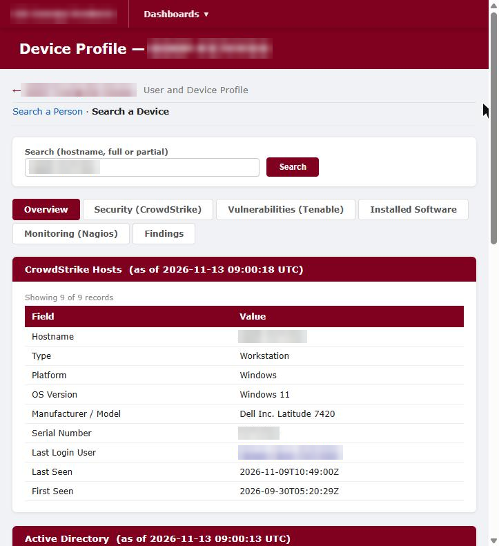
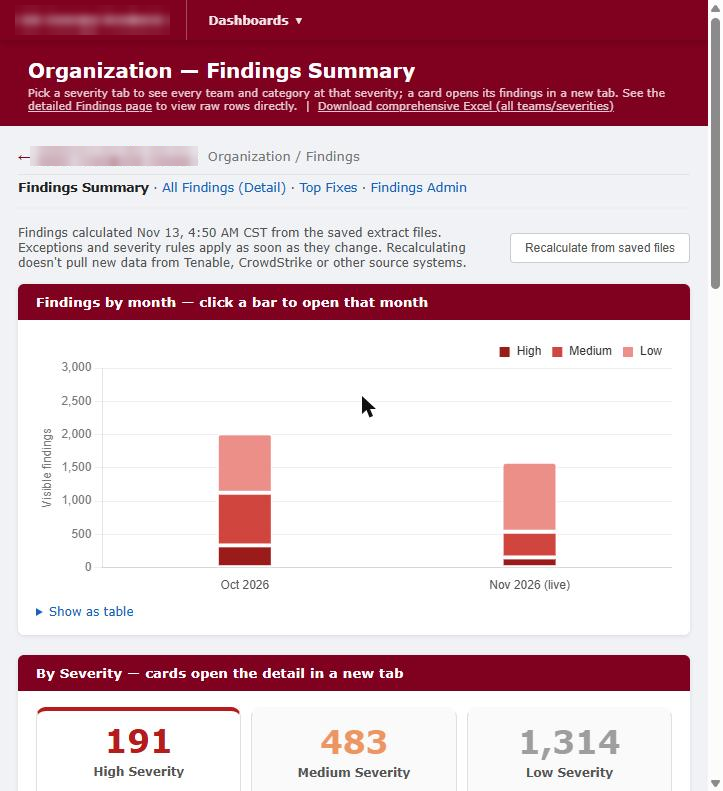
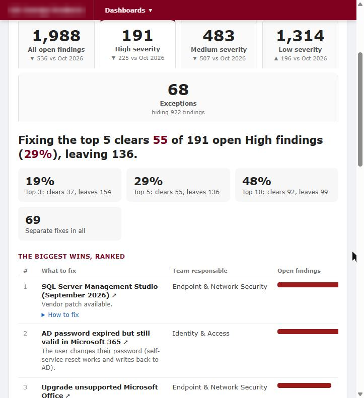
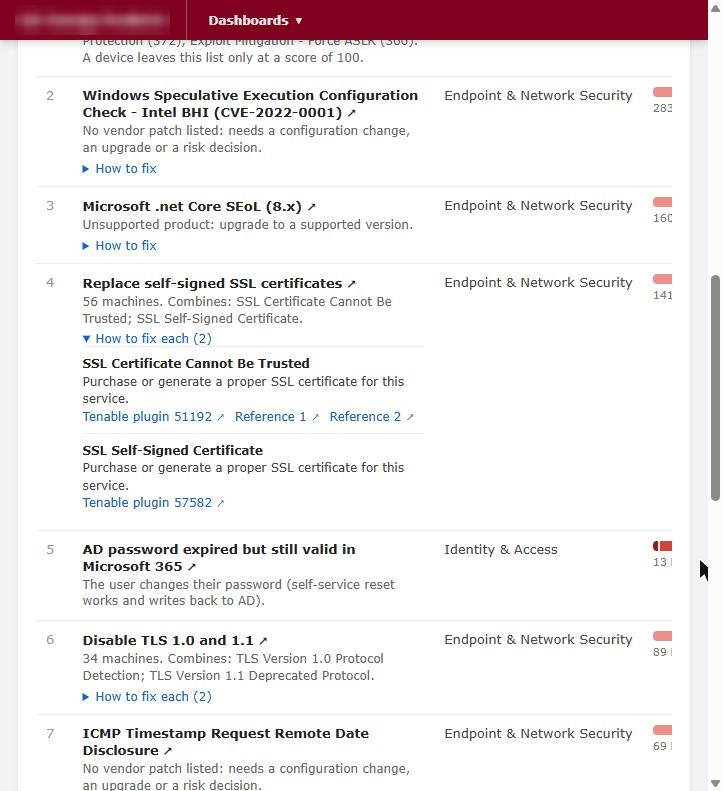

# Build vs. Buy: An IT Operations and Security Dashboard in a Week

## Part 2: Findings That Fit How We Actually Work

---

### 📚 **Series Navigation**
- [Part 1: Architecture and What It Buys Us](it-dashboard-build-vs-buy-part1.md)
- **Part 2: Findings That Fit How We Actually Work** *(Current)*

*[Part 1](it-dashboard-build-vs-buy-part1.md) covered why we built instead of bought and how the data is collected and joined. This part covers what the dashboard actually checks, how findings and exceptions adjust themselves every night, and how it all becomes one ranked list for the monthly review.*

---

## Introduction

[Part 1](it-dashboard-build-vs-buy-part1.md) described the architecture: read-only API access to every source, nightly snapshots on a file share, and a dashboard that joins them at read time. That's the plumbing. This part is about what the plumbing is for — the **findings**.

A finding is a check that compares what *should* be true with what our systems say *is* true: an account HR says is terminated that's still enabled, a laptop with the endpoint agent but no web security client, a vulnerability nobody has patched. We run more than 60 of them every night.

The checks themselves aren't the interesting part — any vulnerability or posture tool has checks. What's interesting is everything a bought tool tends to get wrong for a small or mid-sized team:

- A patch released yesterday shows up as an overdue finding today.
- A laptop one release behind looks exactly as bad as one a year behind.
- A server deliberately excluded from an agent is flagged every single night.
- A finding on a laptop doesn't tell you whose laptop it is, or which country they're in this week.
- "Accepted" findings disappear into a filter nobody remembers setting.

Each of those is a rule *we* decide. In our own dashboard, each one is a few lines of code and a conversation, not a feature request.

---

## Anatomy of a Finding

Every finding has the same shape, whatever source it comes from:

| Part | What it is | Who decides |
|---|---|---|
| **Category** | The check, e.g. "AD computer with no endpoint agent" | Code |
| **Condition** | Which case it is, e.g. "Expired" vs. "Expiring soon", "Server" vs. "Workstation" | Code |
| **Severity** | High / Medium / Low for each condition | Admins, from a screen |
| **Owning team** | Identity, Security, Infrastructure, Email | Code |
| **Subject** | The account or device, joined to the person and their location | The join |
| **Exception** | Accepted, with a reason, who and when — or not | Admins, visible to everyone |

<figure class="thumb" markdown>
{ loading=lazy }
<figcaption>All Findings, filtered to one check: what it is, how it's detected and how to fix it, then each affected asset with its team and severity. Filters include team, type, severity and servers only.</figcaption>
</figure>

Separating *what* is checked from *how serious* it is turned out to matter more than anything else. The review meeting argues about severity all the time — "is a disabled-but-not-deleted account really Medium?" — and that argument now ends with an admin changing a setting, not a code change.

---

## The Findings That Matter

Not every check is equally interesting. Some are housekeeping — license assignments, naming, tidy group structures — and they matter for governance, but they aren't why we built this. These are the ones that are:

### Identity: is everyone who has access supposed to have it?

| Finding | Why it matters |
|---|---|
| Terminated in HR but still enabled (AD or Entra) | The single most important leaver check. HR is the source of truth, not a ticket. |
| ERP account active but HR says terminated | The system no identity tool connects to is exactly where leavers linger. |
| Risky user sign-in (Entra ID Protection) | Risk that's been sitting there, not just risk that just happened. |
| Dangerous account settings — Kerberos pre-auth disabled, unconstrained delegation, reversible encryption, DES-only | The classic Active Directory attack paths, checked every night. |
| Kerberoastable account with an old password | Service accounts are the easiest offline crack in most domains. |
| Admin account password older than policy, or admin account whose owner has left | Privileged accounts outliving their purpose. |
| Directory role assigned directly to a user, not a group | Privilege that bypasses review. |
| Conditional Access policy in report-only mode | A control everybody thinks is on, that isn't. |
| Over-privileged app registration, or app secret expired / expiring | Non-human identities with too much access, and outages waiting to happen. |
| Inbox rule forwarding mail outside the organization | A common sign of a compromised mailbox. |

### Endpoint: is every device protected and patched?

| Finding | Why it matters |
|---|---|
| Vulnerability (Critical/High/Medium/Low), split by patch available or not | The main workload — ranked so the biggest fixes surface first. |
| Domain computer with no endpoint (EDR) agent | A device with no protection at all. |
| EDR agent unhealthy or not checked in | Protected on paper only. |
| EDR Zero Trust Assessment score below threshold | The device's own security posture, by the vendor's measure. |
| Workstation with EDR but no web security client | Protected on the device, unprotected on the internet. |
| Scanner asset with no agent, or no scan results | A device we can't see vulnerabilities on is a device we can't vouch for. |
| Unsupported Windows version | No more patches, ever. |
| Server with no managed local admin password | One shared local password is one lateral movement away. |

### Email, web and network

| Finding | Why it matters |
|---|---|
| Malicious message delivered, malicious link click allowed, top clickers | Who got through the filter, who clicked and who keeps clicking. |
| Web security built-in default admin enabled, weak org-wide password policy, rule disabled | The security tool's own configuration drifting. |
| Network appliance firmware upgrade available | Infrastructure gets vulnerabilities too. |
| VM with no backup protection | Found before the restore is needed, not during. |
| SharePoint site with a broad direct access grant | "Everyone" with edit rights is a data leak waiting to happen. |

---

## Findings That Change on Their Own

<figure class="thumb" markdown>
{ loading=lazy }
<figcaption>The Exceptions tab: automatic exceptions (patch grace, N-1, the scanner-agent tag) alongside a manual one, each with its reason, who or what added it, the findings it covers and a link to see them. Nothing is hidden from view. (Names masked.)</figcaption>
</figure>

This is where owning the rules pays off most. Three kinds of exception create and remove themselves, every night, with no one maintaining a list — and every one of them stays visible on the Exceptions tab.

### Patches released this month: a grace period

Patch Tuesday comes out, and the next morning every scanner reports every device as vulnerable. A bought tool shows that as hundreds of new findings. That isn't a finding; it's the calendar.

We don't hold the operations team responsible for a patch released yesterday. There are good reasons it isn't installed today:

- **People travel.** A laptop that's on a plane, at a customer site or switched off in a bag can't take a patch until it's back online. We need time to confirm the user is available.
- **We test first.** For anything that isn't a zero-day, patches go to a small group of devices first, and only to everyone once that group is clean. A patch going out to every device on day one is the risk, not the fix.

So patches carry a short grace period after release. During it, the vulnerability is excepted automatically — still listed under Exceptions, so everyone can see what's in flight — and when the grace period ends, anything still unpatched becomes a normal finding on its own. In practice, that means last month's patches are expected to be done; this month's are in progress.

### One release behind (N-1)

For products that release constantly — browsers, collaboration clients, runtimes, the monthly Windows cumulative update — being exactly one release behind is normal. The infrastructure team runs some of them one behind on purpose, and a laptop that was offline for a week will be one behind until it catches up.

So a device that is exactly one release behind on a product (N-1) is excepted automatically. Two rules keep this honest:

- **Only N-1.** A device two releases behind isn't "catching up"; it's a finding.
- **Only while the newest release is recent.** Once the newest release is older than our limit, N-1 stops being acceptable — the device has had long enough. That also stops an old vulnerability that never got a newer release from being excepted forever.

The first night this ran, it removed a large share of the vulnerability findings from the list — none of which anyone would have acted on, all of which were cluttering the review.

### Devices deliberately without an agent

Some devices can't or shouldn't run the vulnerability scanner's agent — appliances, certain servers. The security operations team tags them in the scanner itself. The dashboard reads that tag and excepts *only* the "no scan agent" finding for those devices.

That last word matters. Those devices are still scanned over the network, so any vulnerability found on them is still a finding. The tag excuses the missing agent, not the device.

---

## Whose Device Is This, and Where Are They?

A vulnerability on a laptop is only half an answer. To fix it, someone needs to know whose laptop it is and where that person is.

We don't rely on a CMDB assignment for that. Assignments are only as current as the last person who remembered to update them. Instead:

1. **Vulnerability → device:** the scanner reports the hostname.
2. **Device → person:** the endpoint agent reports the last user who logged on to that device. We match that to their Active Directory account.
3. **Person → place:** office, department and location come from the HR system, which our HR sync writes into Active Directory and Entra ID.

So a finding arrives as "this laptop, last used by this person, in this office". For a team supporting people who travel, that changes the conversation: "your laptop needs to be online on Thursday" goes to the right person, in the right time zone, the first time.

<figure markdown>
{ loading=lazy }
<figcaption>Device 360, vulnerabilities tab: the device's open vulnerabilities from the scanner, by severity, each linked to the vendor's write-up.</figcaption>
</figure>
<figure markdown>
{ loading=lazy }
<figcaption>Device 360 overview: the endpoint agent reports the last logged-on user (linked to their User 360) and when the device was last seen, here several days ago, a laptop on the road. (Names masked.)</figcaption>
</figure>

---

## Servers vs. Workstations

The same check doesn't mean the same thing on a server and on a laptop, so checks are scoped by device type where it matters:

- **Web security client** is expected on workstations, not on servers in a data center.
- **Managed local admin passwords** are checked on servers, where a shared local password does the most damage.
- **Stale computer accounts** are reported separately for servers and workstations, so each can carry its own severity.
- **Device 360** shows the same tabs for both, and an empty tab on either is itself a finding: this device isn't covered by that system.

The point isn't the specific rules. It's that they're *ours*, and each one was a short conversation followed by a small change.

---

## Exceptions in the Open

Every security tool has a way to suppress a finding. Most of them make it disappear. We went the other way.

### An exception changes our view, not the source

This is the most important point in the design. An exception lives in the dashboard, and only in the dashboard. It doesn't touch the source system:

- The vulnerability is still open in the scanner.
- The alert is still in the endpoint console.
- The account is still in Active Directory exactly as it was.

What the exception changes is how *our dashboard* counts that finding. It moves out of the open totals and the Top Fixes ranking and into the Exceptions view. If the reason for the exception goes away, or an admin removes it, the finding comes straight back the next time the page loads. Nothing was deleted, so there's nothing to restore.

That's also why an exception is cheap to make and safe to reverse. It's a statement about our priorities, not a change to our environment.

### How an exception is created

Exceptions come from two places.

**Admins, by hand.** A small group of admins (three, in our case) can create an exception at whatever scope fits the decision:

- **One finding:** a single account or device. "This service account is a known exception, owned by Finance, reviewed quarterly."
- **One condition of a check:** for example, every *non-dialog* ERP account with no matching directory account. These are service accounts the ERP uses system to system; nobody signs in with them, so they're expected not to have a Windows (Active Directory) login. One exception covers that whole condition, while ERP accounts that people *do* sign in with and that have no directory account stay visible as findings.
- **A whole check:** rare, and kept on the admin page on purpose, so hiding an entire category is a deliberate act rather than a click in passing.

Admins can create these straight from the findings list or the Top Fixes page while reviewing, and each one requires a reason. One fix can also clear a group of related findings together, and admins can pair those so the group is reviewed as one item.

**Rules, automatically.** The patch grace period, N-1 and the scanner-agent tag described above are built-in exceptions. They're evaluated every night, apply only while their condition holds, and can't be removed from the screen, so nobody turns one off by accident.

### How an exception stays visible

- Every exception records **what** it covers, **why**, **who** decided and **when**.
- Everyone with access to the dashboard can **see** every exception: the Findings Admin page is read-only for everyone and editable only by the admins.
- The monthly review has an **Exceptions tab** next to the findings, with counts per exception and a link to the exact findings each one covers, so the meeting can agree which to reverse.
- Built-in exceptions are listed the same way, with their own reasons, alongside the manual ones.

The test we applied to every part of this: could someone in the review ask "what are we not looking at, and why?" and get a complete answer from the screen? If not, it wasn't done.

An exception is a decision, and decisions should be visible.

---

## From Findings to Meetings: Top Fixes

The last step is turning 60+ checks into a short list a monthly meeting can act on. Top Fixes ranks *fixes*, not findings:

- Vulnerabilities are split by plugin, because "patch the scanner findings" isn't one fix — each vulnerability is.
- Admins can pair fixes that one action clears together (one upgrade that closes five plugins is one fix).
- Each fix shows its severity, owning team, number of findings it would close, and how to fix it — with the vendor's solution and links.
- Month-over-month change shows whether we're winning.

The meeting now starts from "here are the ten fixes that would remove the most risk, by team" and ends with owners. That's the dividend of everything in Part 1: **better visibility, better remediation, better meetings.**

<figure markdown>
{ loading=lazy }
<figcaption>Findings by month, by severity: the trend the monthly review starts from.</figcaption>
</figure>
<figure markdown>
{ loading=lazy }
<figcaption>Top Fixes: totals against last month, and how much of the High list the top 3, 5 and 10 fixes would clear, then the fixes ranked with their owning team.</figcaption>
</figure>
<figure markdown>
{ loading=lazy }
<figcaption>Each vulnerability fix carries the vendor's solution and references, so the owning team can act straight from the list.</figcaption>
</figure>

---

## Lessons Learned

- **Grace and N-1 did more for the review than any new check.** Removing findings no one would act on made the remaining ones credible.
- **Make exceptions expire by rule, not by memory.** An automatic exception that removes itself when its reason no longer applies is safer than a manual one with a review date.
- **Excuse the specific finding, not the device.** The scanner-agent tag taught us this one: a broad exemption would have hidden real vulnerabilities on network-scanned devices.
- **Last logged-on user beats the CMDB.** It's always current, and it's what the person fixing the device actually needs.
- **Severity is a conversation; make it a setting.** Moving severity out of code ended a recurring argument.

---

## Closing Thought

None of these rules is clever. A grace period for new patches, tolerance for one release behind, an exception for devices that can't run an agent, a finding that knows whose laptop it is — any IT manager would describe them the same way. The difference is that, in a bought tool, each of them is a feature request. In our own dashboard, each was a short conversation with an LLM and a review of its work.

That's the real argument for building, for a small or mid-sized team: not that you can out-build a vendor, but that you can make the tool match how your organization actually works — in hours, and without paying per asset for the privilege.

---

## References

- [Part 1: Architecture and What It Buys Us](it-dashboard-build-vs-buy-part1.md)
- [Data Analysis with LLM via MCP Server — Part 1](ai-claude-mcp-analytic-server-part1.md) — ad-hoc questions over the same data
- [Entra User Devices](azure-ad-user-devices.md) — one of the device extracts behind Device 360
- [Create User and assign groups](adds-user-creation.md) and [Update User](adds-user-update.md) — how HR attributes reach Active Directory

---

*This article documents a production implementation. Names, identifiers and tenant-specific values have been removed or generalized, and screenshots are masked.*
